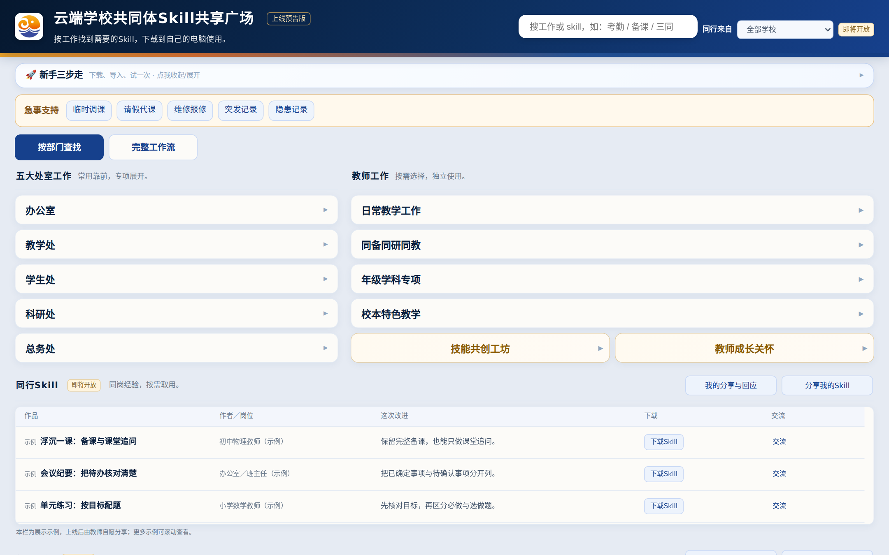
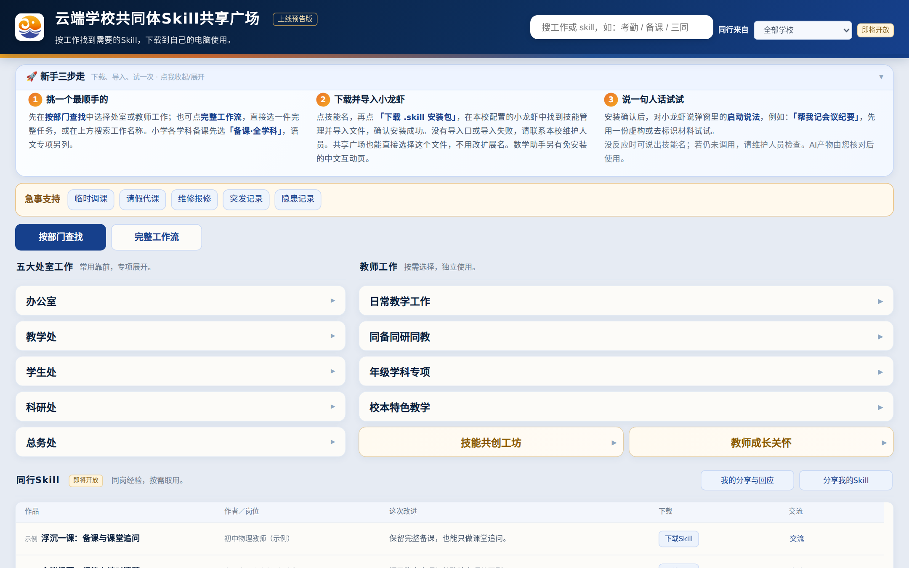
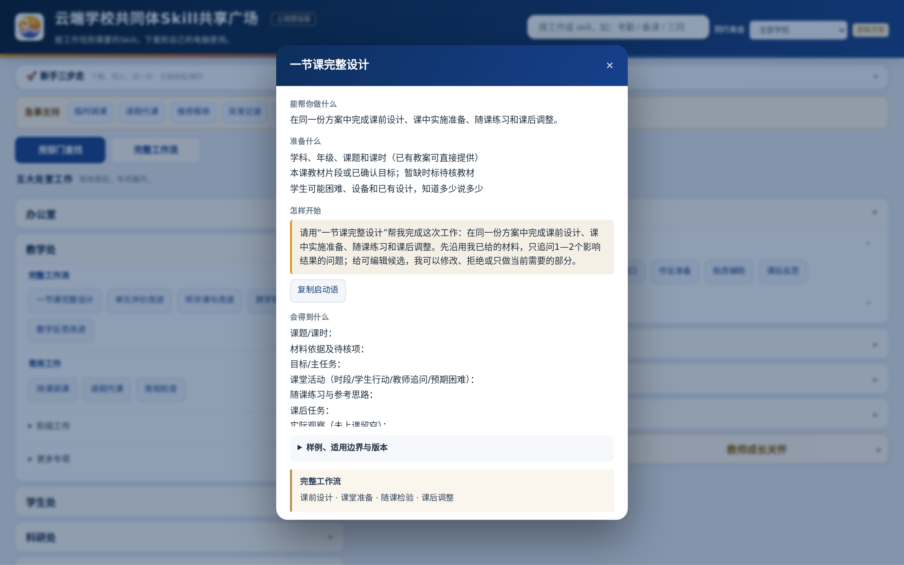
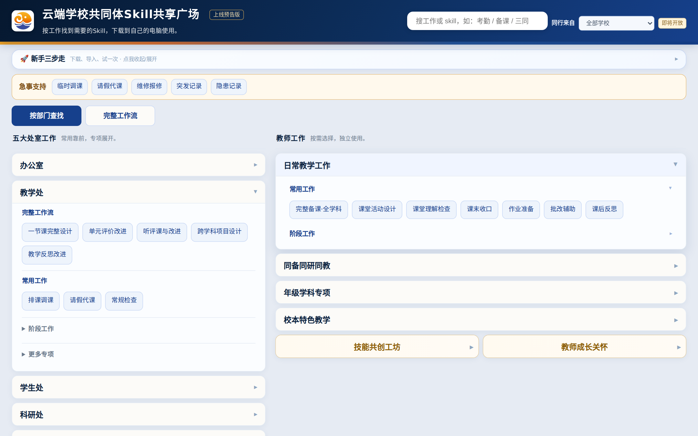
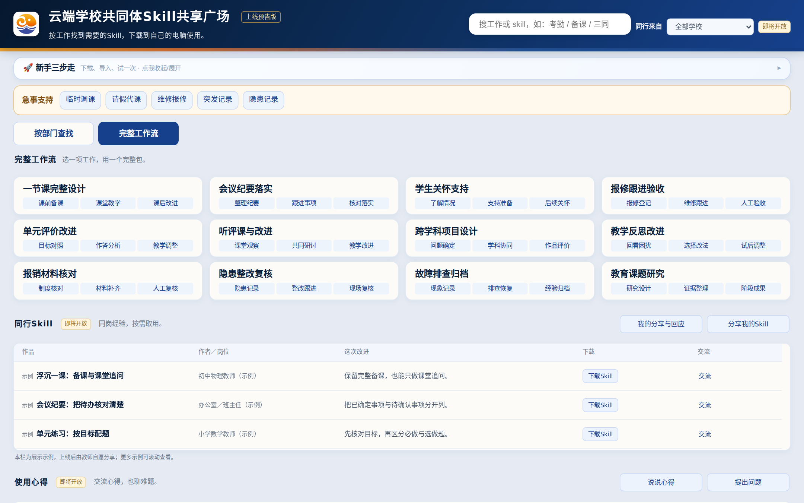

# 云端学校共同体 Skill 共享广场

**作者：汤幸初（AI 老汤）** · 深圳市云端学校 教育 AI+ 中心

把学校日常工作做成了 140 个 AI Skill，按处室和教师工作整理在一个看板里：找到要做的事，下载安装包，导入 AI 助手，说一句话就能开始。现在是上线预告版：Skill 可以直接下载使用，同行分享和交流将在上线后开放。

*Yunduan School Skill Square — 140 agent skills for everyday K-12 school work, by Tang Xingchu.*

**[打开在线看板](https://tang1693.github.io/yunduan-ai-skills/)** · **[技能目录](技能目录.md)** · **[观看演示视频（1 分 43 秒）](https://tang1693.github.io/yunduan-ai-skills/docs/media/demo.mp4)**

## 演示视频

https://github.com/user-attachments/assets/e2d4d944-62bc-4ea3-8255-6684622fb4b9

## 怎么用：新手三步走

1. **挑一个最顺手的。** 打开看板，用「按部门查找」选处室或教师工作；也可以点「完整工作流」，选一件从头做到尾的事；或者在右上角直接搜，比如“会议”“备课”“报修”。
2. **下载并导入。** 点技能名，再点「下载 .skill 安装包」，在本校配置的小龙虾（AI 助手）里找到技能管理，导入这个文件。
3. **说一句人话试试。** 安装好后，说出弹窗里的启动说法，例如“帮我记会议纪要”。

先用虚构或去掉个人信息的材料试一次；AI 给出的东西，由你核对后再用。

| 新手三步走 | 技能卡片 |
|---|---|
|  |  |
| **按部门查找** | **完整工作流** |
|  |  |

## 看板里有什么

- **五大处室工作**：办公室、教学处、学生处、科研处、总务处，常用工作排在前面，专项展开。
- **教师工作**：日常教学、同备同研同教、年级学科专项、校本特色教学（扶摇阁、青云学堂、小鲲学堂、小云学堂）、技能共创工坊、教师成长关怀。
- **急事支持**：临时调课、请假代课、维修报修、突发记录、隐患记录。
- **完整工作流**：一节课完整设计、会议到落实闭环等，一件事用一个完整包。
- **同行 Skill 与使用心得（即将开放）**：上线后，老师可以自愿分享自己改进过的 Skill，交流用法、提出问题。现在页面上的条目都是展示示例。

全部 140 个 Skill 的名称和用途见 [技能目录](技能目录.md)。

## 仓库里的文件

| 路径 | 内容 |
|---|---|
| `index.html` | 看板本体，单个文件。下载后双击就能离线使用；在线版就是 GitHub Pages 上的这个文件。 |
| `skills/` | 140 个 Skill 的原文，每个一个文件夹：`SKILL.md`、`manifest.json`，有的带参考资料和脚本。 |
| `技能目录.md` | 按看板分类列出的全部 Skill。 |
| `docs/` | 截图和演示视频。 |
| `CREDITS.md` | 改编和合作的 Skill 及原作者。 |

## 作者与致谢

看板和 Skill 由汤幸初（AI 老汤）设计、编写和维护。少数 Skill 改编自或参考了他人的作品，原作者和许可写在 [CREDITS.md](CREDITS.md)。

觉得哪件顺手、哪件别扭，欢迎在 Issues 里告诉老汤。内容更新至 2026 年 10 月；遇到教材改版、制度调整，以最新文件为准。

## 版权

© 2026 汤幸初。使用条件见 [LICENSE.md](LICENSE.md)。
